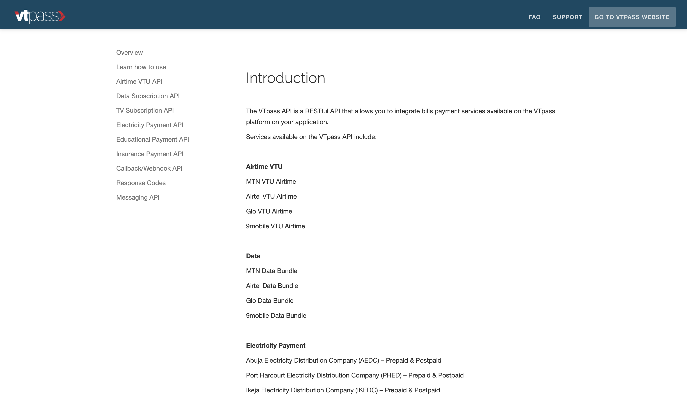
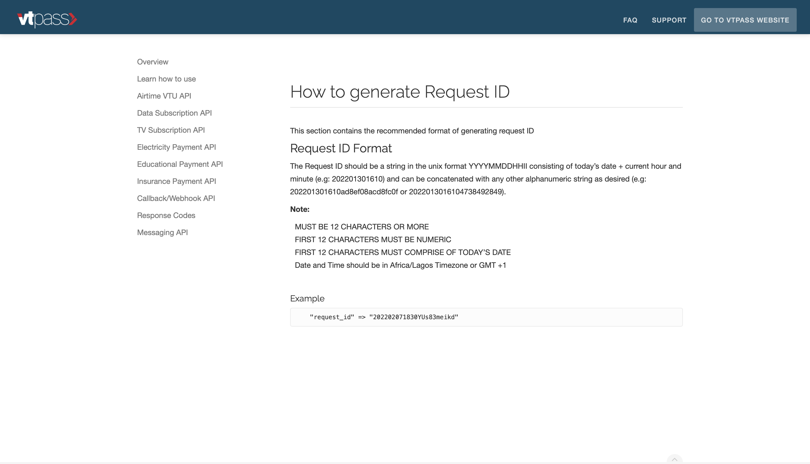
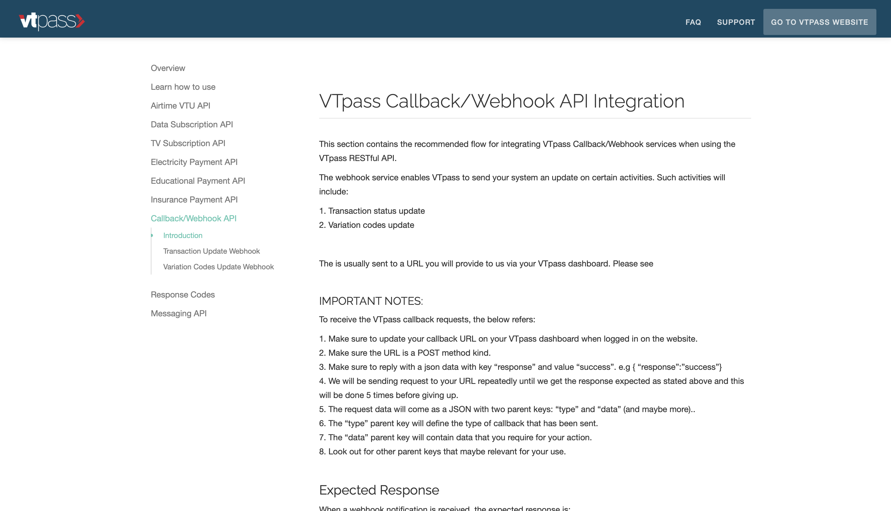
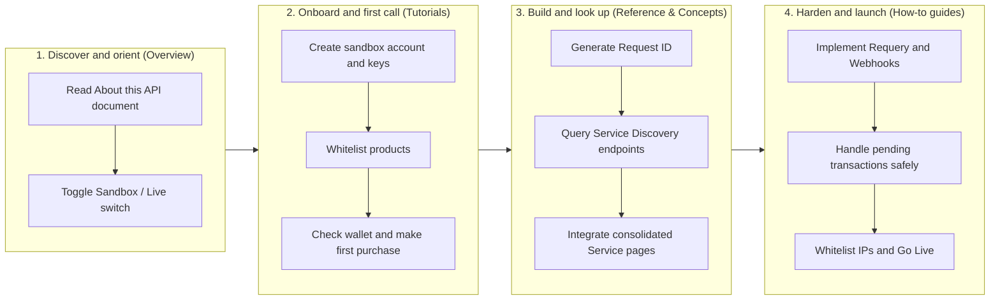
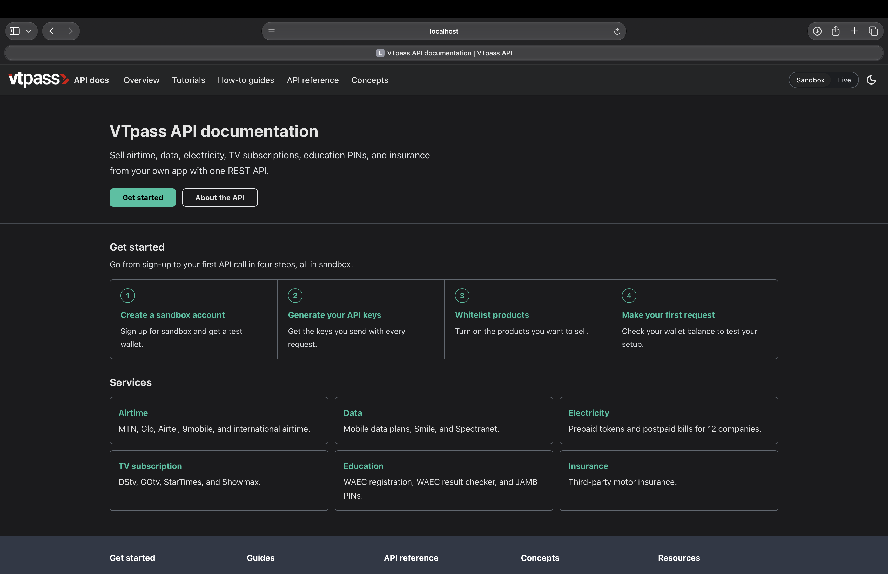
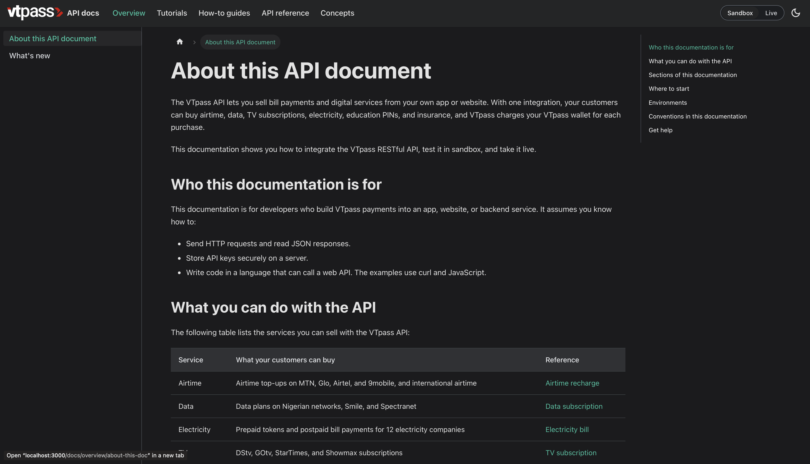
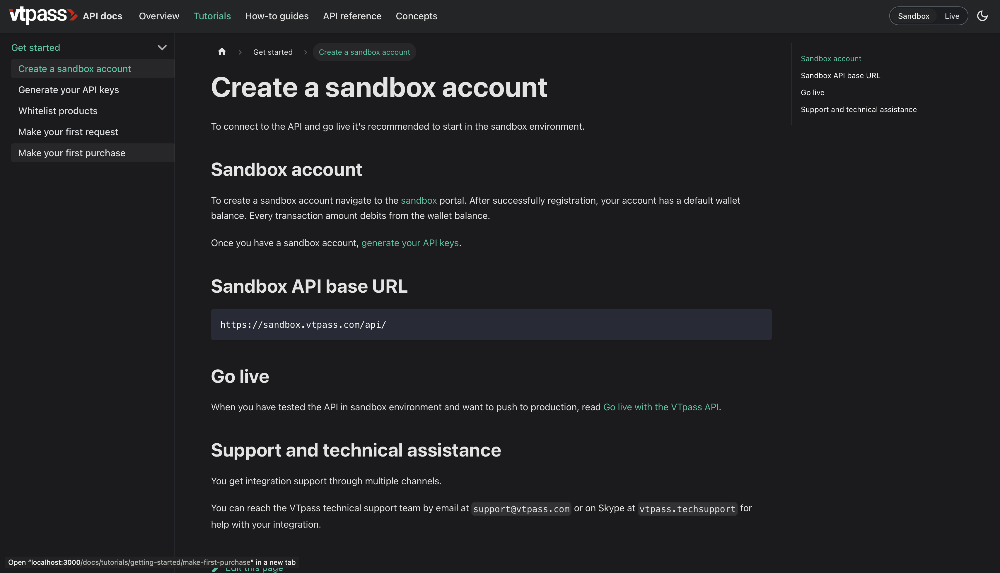
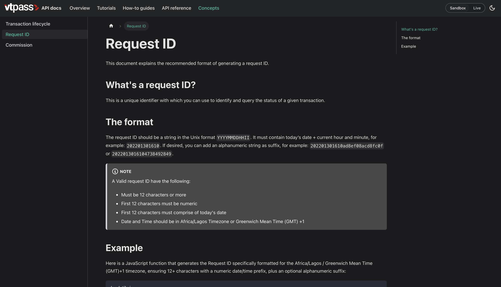

# VTpass API documentation: portfolio case study

> [!NOTE]
> **Portfolio case study**: this project is an independent documentation engineering and developer experience redesign of the [VTpass API documentation](https://www.vtpass.com/documentation/). It uses [Docusaurus](https://docusaurus.io) and [Vale](https://vale.sh) to demonstrate information architecture, content consolidation, interactive developer tooling, and style guide automation.

The VTpass API lets developers sell airtime, data, electricity, TV subscriptions, education PINs, and insurance from their own apps.

This redesign reorganizes the original documentation into clear sections based on the [Diátaxis framework](https://diataxis.fr), merges duplicate provider pages into one canonical reference page per service, and adds the guides and concepts developers need to build a reliable integration.

---

## 1. Original documentation and measurable friction points

The original VTpass API documentation creates friction for developers trying to understand the integration lifecycle, look up endpoints, or debug edge cases.

### Original pages

**Original introduction and flat sidebar navigation:**


**Original Request ID specification:**


**Original Callback and Webhook integration page:**


### Key measurable friction points

1. **Extreme page fragmentation and content duplication: 30+ provider pages reduced to 6 service pages**
   - **The friction**: the original documentation created a separate page for every single provider across every service category, such as 4 separate pages for Airtime networks, 6 for Data, 12 for Electricity distribution companies, and 4 for TV providers. However, every provider in a category calls the exact same `/api/pay` and `/api/merchant-verify` endpoints with identical payload schemas.
   - **Measurable impact**: developers integrating multi-provider bill payments had to open and cross-reference **12 separate pages** just to find the `serviceID` and test meter numbers for electricity providers, which resulted in an **83% redundancy rate** across reference pages.
2. **Unimplementable specifications and missing code helpers: 0 runnable examples for Request ID and Webhooks**
   - **The friction**: the original docs described critical integration requirements in plain text or capital-letter notes without runnable code. For example, the original Request ID page in `before_2.png` lists rules in capital letters requiring 12 or more numeric characters starting with today's date in the `Africa/Lagos` timezone, followed only by a one-line PHP array fragment. Similarly, the webhook page in `before_3.png` contains unfinished sentences and zero handler examples.
   - **Measurable impact**: developers had to write custom timezone-aware `YYYYMMDDHHII` string generators in `Africa/Lagos` from scratch, making malformed `request_id` responses such as `014` and `016` common first-call failures.
3. **High time-to-first-call and scattered onboarding prerequisites**
   - **The friction**: no end-to-end onboarding tutorial existed. Core prerequisites—creating a sandbox account, generating API keys, whitelisting products, understanding authentication headers such as `api-key`, `public-key`, and `secret-key`, and running a first transaction—either lived under a generic *Learn how to use* menu or didn't exist at all.
   - **Measurable impact**: a new developer had to piece together information across **5+ unlinked pages** before making a single valid sandbox request, and had no documented checklist for moving from sandbox to live, including IP whitelisting.
4. **Static environment URLs and inconsistent parameter tables**
   - **The friction**: the original pages hardcoded sandbox and live base URLs inconsistently, forcing developers to manually edit URLs when copying snippets. Furthermore, request tables used cryptic `M` and `O` shorthand for mandatory and optional fields, and omitted complete response field descriptions and actionable recovery steps for pending transaction codes `099` and `000`.
   - **Measurable impact**: increased copy-paste errors when transitioning between sandbox testing and production, and higher integration risk around double-charging on pending transactions.

---

## 2. Information architecture: proposed sidebar navigation and user journey

To resolve the flat, provider-scattered navigation of the original site, the redesign structures the documentation around the **[Diátaxis](https://diataxis.fr)** framework into five dedicated top-level sections, each with its own focused sidebar.

### Proposed sidebar navigation

```text
VTpass API Documentation
├── Overview
│   ├── About this API document
│   └── What's new
├── Tutorials
│   └── Get started
│       ├── 1. Create a sandbox account
│       ├── 2. Generate your API keys
│       ├── 3. Whitelist products
│       ├── 4. Make your first request
│       └── 5. Make your first purchase
├── How-to guides
│   ├── Handle pending transactions
│   ├── Webhooks
│   │   ├── Set up your callback URL
│   │   ├── Handle transaction update webhooks
│   │   └── Handle variation codes update webhooks
│   └── Go live with the VTpass API
├── API reference
│   ├── Authentication
│   ├── Wallet balance
│   ├── Requery
│   ├── Service discovery
│   │   ├── Available services
│   │   ├── Service IDs
│   │   ├── Variation codes
│   │   └── Product options
│   ├── Services
│   │   ├── Airtime recharge        (consolidates MTN, Glo, Airtel, 9mobile, International)
│   │   ├── Data subscription       (consolidates MTN, Glo, Airtel, 9mobile, Smile, Spectranet)
│   │   ├── Electricity bill        (consolidates all 12 DisCos into 1 page + comparison table)
│   │   ├── TV subscription         (consolidates DStv, GOtv, StarTimes, Showmax)
│   │   ├── Education               (consolidates WAEC registration, WAEC result checker, JAMB)
│   │   └── Insurance               (Third-party motor insurance)
│   └── Response codes
└── Concepts
    ├── Transaction lifecycle
    ├── Request ID
    └── Commission
```

### Developer user journey

The redesigned architecture maps directly to the four stages of a developer's integration lifecycle:



1. **Discover and orient in `Overview`**: a developer lands on the homepage or [About this API document](docs/overview/about-this-doc.md), reviews all 6 supported service categories at a glance, learns the difference between the Sandbox and Live environments, and picks the entry point that matches their goal.
2. **Onboard and make a first call in `Tutorials`**: new developers follow a linear, 5-step [Get started](docs/tutorials/getting-started/create-sandbox-account.md) path—from creating a sandbox account and whitelisting products to checking their wallet balance and completing a sandbox airtime purchase with a status requery.
3. **Build and look up in `API reference` and `Concepts`**: while building features, developers copy the ready-to-use `Africa/Lagos` JavaScript generator from [Request ID](docs/explanation/request-id.md), check status transitions in [Transaction lifecycle](docs/explanation/transaction-lifecycle.md), and look up endpoints in the consolidated [Services](docs/reference/services/electricity.mdx) reference pages—using the global **Sandbox / Live** toggle in the navigation bar to switch base URLs across all code blocks and tables automatically.
4. **Harden and launch in `How-to guides`**: before serving real customers, developers follow task-focused guides to [handle pending transactions](docs/how-to/handle-pending-transactions.mdx) without double-debiting, verify [webhooks](docs/how-to/webhooks/set-up-callback-url.mdx), and complete the production checklist in [Go live with the VTpass API](docs/how-to/go-live.md).

---

## 3. Redesigned documentation screenshots

**Redesigned landing page with 4-step onboarding cards, service directory, and global Sandbox/Live switch:**


**Redesigned Overview section with target audience, service table, and environment conventions:**


**Redesigned step-by-step Get Started tutorial with dedicated sidebar and table of contents:**


**Redesigned Request ID concept page with clear validation callouts and a copyable JavaScript helper:**


---

## What's in the redesign
- **Structure based on [Diátaxis](https://diataxis.fr)**: the docs have five sections, which are Overview, Tutorials, How-to guides, API reference, and Concepts.
- **One reference page for each service**: for example, the 12 electricity company pages are one [Electricity](docs/reference/services/electricity.mdx) page, with a table of how the companies differ.
- **Sandbox and Live switch**: a switch in the navigation bar changes the base URL in every code sample and endpoint table.
- **New content**: a first-purchase tutorial, guides for pending transactions, webhooks, and going live, and concept pages for the transaction lifecycle, request IDs, and commission.
- **Consistent style**: content follows the [Google developer documentation style guide](https://developers.google.com/style), checked with [Vale](https://vale.sh).

## Content structure
The following table describes where each type of content lives:

| Section | Folder | Contents |
| :--- | :--- | :--- |
| Overview | `docs/overview` | About this API document, What's new |
| Tutorials | `docs/tutorials` | Getting started, from a sandbox account to a first purchase |
| How-to guides | `docs/how-to` | Handle pending transactions, webhooks, and going live |
| API reference | `docs/reference` | Authentication, wallet balance, requery, service discovery, services, and response codes |
| Concepts | `docs/explanation` | Transaction lifecycle, request ID, and commission |

Each section has its own sidebar, generated from its folder. To order pages, set `sidebar_position` in each page's front matter, and `position` in each folder's `_category_.json`.

## Requirements
- Node.js 20 or later
- [Vale](https://vale.sh/docs/install), to check writing style

## Run the site locally
1. Install dependencies:

   ```bash
   npm install
   ```

2. Start the development server:

   ```bash
   npm start
   ```

   The site opens at `http://localhost:3000`. Most changes reload automatically.

If you add or remove a file in `src/theme`, or move or rename pages, restart the server and clear the cache:

```bash
npm run clear && npm start
```

## Write and edit pages
Follow these conventions so new pages match the rest of the site:

- **Tables**: introduce every table with a sentence that calls it the following table and ends with a colon. In request field tables, use a **Required** column with `Yes` or `No`.
- **Code samples**: give each request a curl example and a JavaScript example, in `<Tabs>`. Use the sandbox base URL `https://sandbox.vtpass.com/api` in examples.
- **Endpoint URLs in tables**: use `<EnvUrl path="/api/pay" />` instead of a full URL, so the URL follows the Sandbox and Live switch. You don't need to import it.
- **Code that mustn't change with the switch**: add `noenv` to the code fence, for example ` ```js noenv `.
- **API field names**: write them exactly as the API returns them, including its misspellings, such as `convinience_fee`.
- **Links**: link to other pages with absolute paths, such as `/docs/reference/requery`. The build fails on broken links.

## Check writing style
Run Vale on the docs before you open a pull request:

```bash
vale docs
```

The Vale configuration is in `.vale.ini`, and uses the Google style. To accept a correct term that Vale flags, such as a product or place name, add it to `styles/config/vocabularies/VTpass/accept.txt`.

> [!NOTE]
> Vale checks the text inside inline code when a full stop or comma directly follows the code. If Vale flags text in inline code, reword the sentence so that the code isn't followed by punctuation.

## Build
Build the static site:

```bash
npm run build
```

The build writes the site to the `build` folder, and fails if any page has a broken link. To preview the build, run `npm run serve`.

To check the TypeScript in `src`, run `npm run typecheck`.

## Project layout
The following table describes the main files and folders:

| Path | Contents |
| :--- | :--- |
| `docs/` | Documentation pages written in Markdown and MDX |
| `src/pages/index.tsx` | Homepage |
| `src/components/EnvToggle/` | Sandbox and Live switch in the navigation bar |
| `src/components/EnvUrl/` | Endpoint URL that follows the switch |
| `src/theme/` | Docusaurus overrides that add the switch to code blocks, the navigation bar, and MDX pages |
| `src/utils/vtpassEnv.ts` | Saves the selected environment, and swaps sandbox URLs for live URLs |
| `src/css/custom.css` | Site styles, including table styles |
| `static/img/` | Logos and images |
| `styles/` | Vale styles and vocabulary |
| `docusaurus.config.ts` | Site configuration, navigation bar, and footer |
| `sidebars.ts` | Sidebar for each section |

## Deploy
The site is static, so you can host the `build` folder on any static hosting service.

To deploy to GitHub Pages, run one of the following commands. They build the site and push it to the `gh-pages` branch.

With SSH:

```bash
USE_SSH=true npm run deploy
```

Without SSH:

```bash
GIT_USER=<your-github-username> npm run deploy
```
